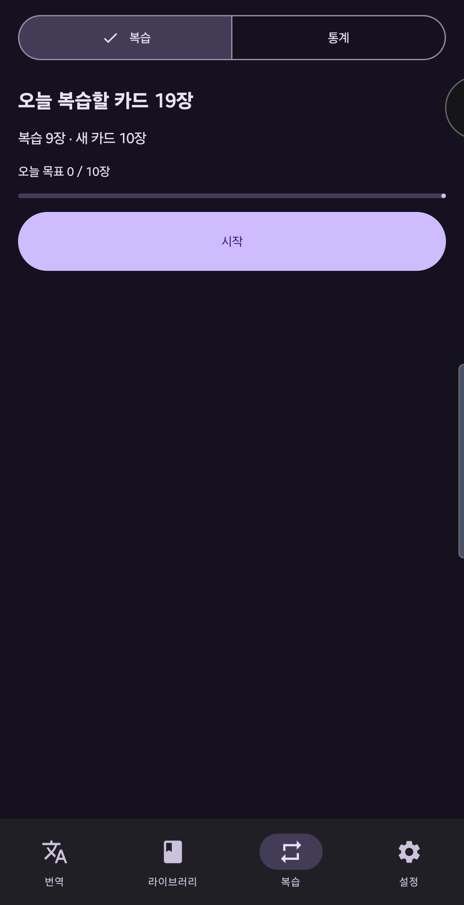
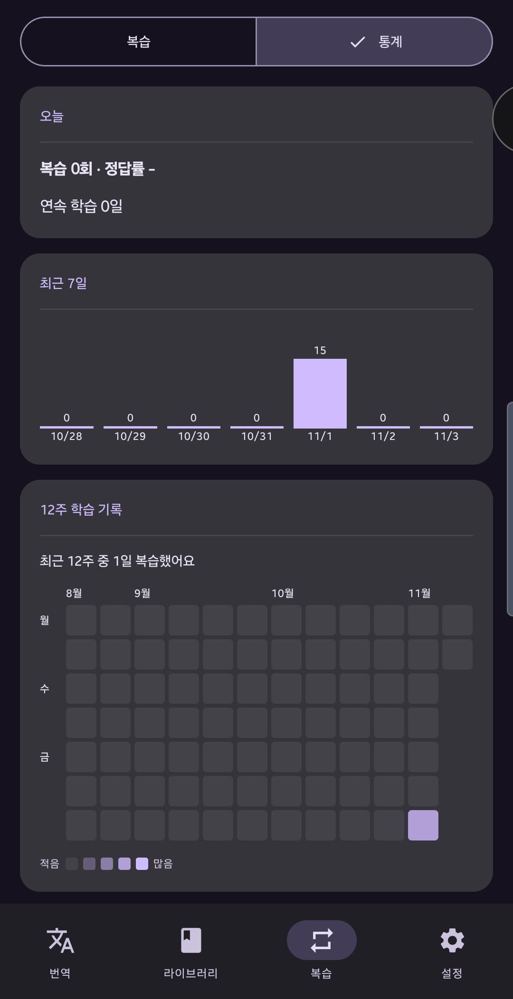
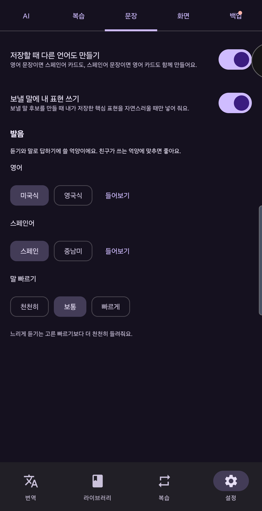
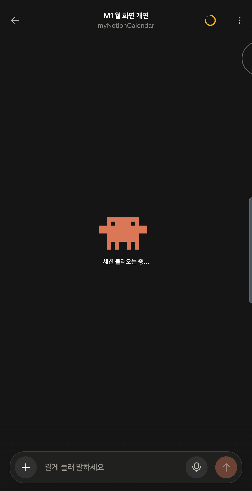

# ChatLearn

친구와 나눈 영어·스페인어 대화를 저장하고, 간격 반복으로 복습하는 Android 앱입니다. 번역과 첨삭은 Google Gemini가 맡습니다.

## 주요 기능
- **번역 탭**
  - 받은 말: 친구 메시지를 붙여넣으면 뜻과 표현 설명을 보여 줍니다. 여러 줄은 문장별로 골라 저장합니다.
  - 보낼 말: 한국어로 하고 싶은 말을 쓰면 자연스러운 표현 후보를 만듭니다.
  - 첨삭: 내가 쓴 문장을 고쳐 주고 바뀐 부분을 표시합니다.
- **라이브러리**: 저장한 문장을 폴더·태그·상태별로 묶어 보고 검색합니다.
- **복습**: 빈칸 채우기·번역·받아쓰기, 음성 입력, 듣고 따라 말하기, 하루 목표와 연속 학습일.
- **통계**: 12주 학습 기록(히트맵).
- **그 밖에**: 홈 화면 위젯, 런처 바로가기 4개, 복습 알림, 밝기·억양 설정, 백업 내보내기·가져오기.

## 화면
실기기(Galaxy S25+, 어두운 테마)에서 찍은 화면입니다. 저장한 문장이 보이는 화면은 개인 대화가 들어 있어 싣지 않았습니다.

| 복습 | 통계 | 설정: 발음 | 설정: 화면 |
|---|---|---|---|
|  |  |  |  |

## 시작하기
1. [Google AI Studio](https://aistudio.google.com/apikey)에서 무료 Gemini API 키를 발급받습니다.
2. 앱을 설치하고 설정 > AI에 키를 붙여넣습니다. 키는 기기의 암호화 저장소에만 저장되며 저장소에는 들어 있지 않습니다.

## 빌드와 테스트
JDK 21과 Android SDK(compileSdk 37)가 필요합니다. JDK 25에서는 Robolectric 테스트가 돌지 않습니다.

```bash
./gradlew :app:assembleDebug
./gradlew :app:testDebugUnitTest
./gradlew :app:assembleRelease   # 폰에 설치하는 출시 빌드
```

**서명 키**: 출시 빌드도 디버그 키(`~/.android/debug.keystore`)로 서명합니다. 다른 키로 빌드한 앱은 폰의 앱을 지우지 않고는 업데이트할 수 없습니다(데이터가 지워짐). 키는 OneDrive `ChatLearn/chatlearn-signing.keystore`에 백업해 두었습니다. 새 PC에서는 빌드하기 전에 이 파일을 `~/.android/debug.keystore`로 복사하세요.

`tools/fake_gemini.py`는 화면 흐름 시험용 가짜 Gemini 서버입니다(실제 AI가 아닙니다). 사용법은 파일 머리말을 보세요. 디버그 빌드만 이 서버 주소를 쓸 수 있습니다.

## 기술 스택
Kotlin, Jetpack Compose(Material 3 Expressive), Room, DataStore, OkHttp, kotlinx.serialization, Glance(위젯). minSdk 26.

## 라이선스
[MIT](LICENSE)
